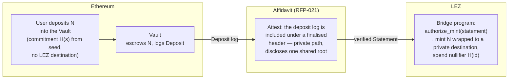

# Causeway — a privacy-preserving Ethereum ⇄ LEZ bridge on Affidavit

This directory holds the **RFP-022 proposal** ([`PROPOSAL-022.md`](PROPOSAL-022.md)) and a
runnable demonstration of its inbound leg's core: authorising a wrapped-token mint from a
verified [Affidavit](../README.md) statement, with no trusted party.

Causeway is the companion to [Affidavit](../README.md) (RFP-021). Affidavit proves that
something happened on Ethereum; Causeway is the first consumer that acts on it — a
lock-and-mint bridge whose mint is authorised by a proof, not a signer.

## The seam this fills

LEZ v0.4 already ships the cross-zone wrapped-token plumbing — `wrapped_token`, `bridge`,
`cross_zone_inbox/outbox/marker` in `lez/programs`. But the inbox hard-codes
`l1_inclusion_witness must be None in v1`: today the mint **trusts** that the Ethereum
deposit happened. Causeway fills that `None` with an Affidavit statement.



Minting runs as a **private** LEZ execution over Affidavit's `AttestPrivate` path, so the
public transaction shows only a nullifier, the amount and the token — never which deposit
funded it (Privacy Preservation #1). The outbound leg (burn on LEZ → release on Ethereum,
verified natively on Ethereum) is the bridge's own work and is specified in the proposal.

## What runs here today

`causeway-mint-demo` is the deterministic core of the inbound mint, written against
`affidavit-core`'s real `Statement` type:

```console
cargo test --release        # 2 tests, on the real mainnet USDC fixture
```

The tests take a **genuine** Affidavit statement — produced by `affidavit_core::statement::attest`
over the real receipt proof in [`../testdata/mainnet/block-26050794`](../testdata) — and:

- authorise a wrapped mint of the exact deposited amount to a private destination;
- derive a one-time nullifier from the statement id and refuse the replay (Reliability #3);
- refuse a deposit into another vault, an unregistered token, a non-denomination amount,
  and a statement from another instance or network (Security #2, #3).

This is the seam, on real data. The vault contract, the outbound burn-proof verifier, the
privacy construction, the Logos modules and the recovery scanner are the grant milestones in
[`PROPOSAL-022.md`](PROPOSAL-022.md).

## License

MIT OR Apache-2.0.
