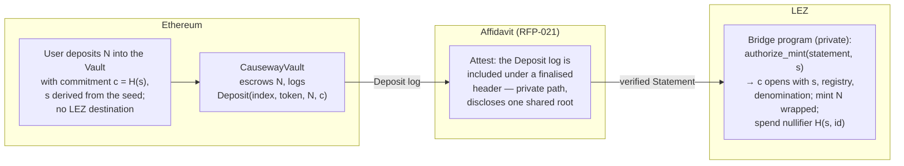

# Causeway — a privacy-preserving Ethereum ⇄ LEZ bridge on Affidavit

This directory holds the **RFP-022 proposal** ([`PROPOSAL-022.md`](PROPOSAL-022.md)), its
design documents ([`docs/`](docs)), and the parts of the bridge that already run: the
Ethereum vault with its test suite and measured gas, the inbound mint authorisation over
genuine Affidavit statements, and seed-only position recovery in two languages.

Causeway is the companion to [Affidavit](../README.md) (RFP-021). Affidavit proves that
something happened on Ethereum; Causeway is the first consumer that acts on it — a
lock-and-mint bridge whose mint is authorised by a proof, not a signer.

## The seam this fills

LEZ v0.4 already ships the cross-zone wrapped-token plumbing — `wrapped_token`, `bridge`,
`cross_zone_inbox/outbox/marker` in `lez/programs`. But the inbox hard-codes
`l1_inclusion_witness must be None in v1`: today the mint **trusts** that the Ethereum
deposit happened. Causeway fills that `None` with an Affidavit statement.



Minting runs as a **private** LEZ execution over Affidavit's `AttestPrivate` path, so the
public transaction shows only a nullifier, the amount and the token — never which deposit
funded it (Privacy Preservation #1). The nullifier is derived from the depositor's secret
and the deposit, so it is unique per deposit and not computable by an observer. The
outbound leg (burn on LEZ → release on Ethereum, verified natively on Ethereum) is specified
in [`docs/OUTBOUND.md`](docs/OUTBOUND.md).

## What runs here today

| piece | what it shows | tests |
|---|---|---|
| [`contracts/`](contracts) — `CausewayVault.sol`, compiled with solc 0.8.28 and run on an in-process EVM (Cancun) | deposits of native ETH, an ERC-20 and a USDT-style no-return token on a fixed denomination grid; immutable pairing (chain, vault, zone, program, burn image); admin and freezer as independent roles; per-token and global rolling caps; `release` on a proven LEZ burn with pairing, finality, replay, proof, freeze, cap and supply checks; registry changes with minimum user impact; a gas table | 21 |
| [`src/lib.rs`](src/lib.rs), [`tests/seam.rs`](tests/seam.rs) — inbound mint authorisation | Affidavit's real receipt-proof path attests the `Deposit` log that the **compiled vault emitted on a real EVM** ([`testdata/vault`](testdata/vault)); the depositor's seed-derived secret opens the commitment and yields a one-time nullifier; someone else's deposit, a replay, a wrong vault, token, denomination, instance or network, and a genuine mainnet ERC-20 `Transfer` are refused | 4 + 2 |
| [`src/recovery.rs`](src/recovery.rs), [`contracts/test/recovery.test.mjs`](contracts/test/recovery.test.mjs) — recovery from the seed alone | the same derivation in Rust and JavaScript, pinned to one vector; a restored client scans real `Deposit` logs and finds exactly its own deposits, with a gap limit | 5 + 4 |

```console
cargo test --release                  # 11 Rust tests
cd contracts && npm ci && npm test    # 25 JavaScript tests on the in-process EVM; writes artifacts/gas.json
npm run fixture                       # regenerates testdata/vault/deposit-receipts.json from the compiled vault
```

Measured gas (mock verifier; the real Groth16 verification adds its own cost, see
[`docs/COSTS.md`](docs/COSTS.md)): `depositETH` 86,035 · `depositERC20` 108,984 ·
`release` 160,219 (ERC-20) / 98,213 (ETH). Vault bytecode: 7,914 bytes.

## Documents

| | |
|---|---|
| [`docs/DESIGN.md`](docs/DESIGN.md) | architecture, trust, the vault precisely, invariants, governance, failsafe |
| [`docs/OUTBOUND.md`](docs/OUTBOUND.md) | burn proof, settled-state anchor (two routes), release step by step |
| [`docs/PRIVACY.md`](docs/PRIVACY.md) | what is public on each leg, why the private attestation path matters, denominations and fees, residual correlations, the M2 test suite |
| [`docs/RECOVERY.md`](docs/RECOVERY.md) | seed-only recovery of deposits and burns, with the pinned vector |
| [`docs/COSTS.md`](docs/COSTS.md) | measured gas, LEZ-side estimates anchored on Affidavit's measurements, what is not yet measured |
| [`docs/COMBINED.md`](docs/COMBINED.md) | one engineer delivering RFP-021 and RFP-022 together: dependencies, timeline, price |

The bridge program on LEZ, the burn guest and its Groth16 wrapping, the settled-state
anchor, the Logos modules and the mini-app are the grant milestones in
[`PROPOSAL-022.md`](PROPOSAL-022.md).

## License

MIT OR Apache-2.0.
