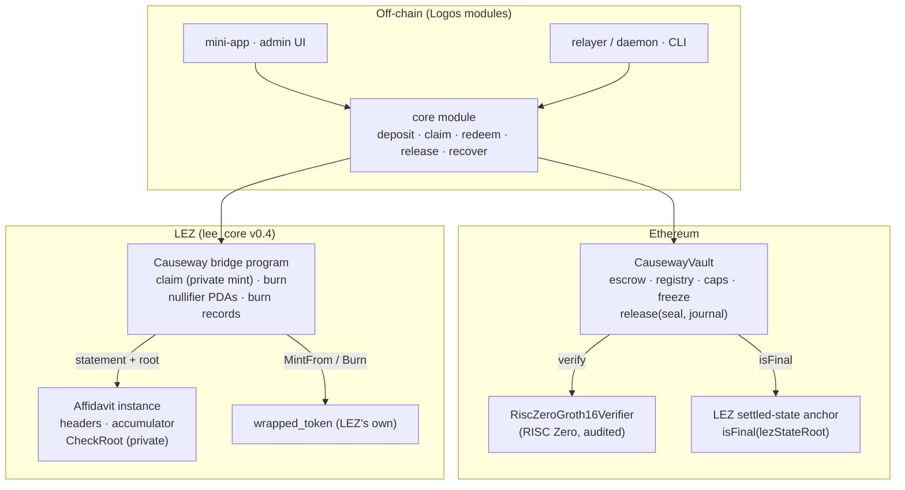

# Causeway design

A trustless, privacy-preserving lock-and-mint bridge between Ethereum and LEZ, built as the
first consumer of the Affidavit attestation primitive (RFP-021). This document is the
architecture; [OUTBOUND.md](OUTBOUND.md), [PRIVACY.md](PRIVACY.md), [RECOVERY.md](RECOVERY.md)
and [COSTS.md](COSTS.md) go deeper on one piece each, and [COMBINED.md](COMBINED.md) is the
plan for building it together with Affidavit.

## In one paragraph

An Ethereum **vault** escrows ETH or an ERC-20 and logs a deposit that names no
destination. **Affidavit** proves the deposit is included under a finalised Ethereum header.
A LEZ **bridge program** mints the wrapped token in a **private** execution that checks the
Affidavit statement against the instance's shared accumulator root and reveals only a
secret-derived nullifier, the token and the amount. Burning the wrapped token produces a
record bound to a committed Ethereum recipient; the vault **releases** the original on a
RISC Zero proof of that burn, verified natively on Ethereum, once the LEZ state the burn
sits in is final. No signer, federation or relayer is ever trusted with funds.

## Components



| component | status | where |
|---|---|---|
| Vault: deposits, registry, denominations, caps, freeze, release with pairing, finality, nullifier, proof checks; native ETH and no-return-value tokens | **built**, 21 tests, gas measured | [`../contracts/src/CausewayVault.sol`](../contracts/src/CausewayVault.sol), [`../contracts/test/vault.test.mjs`](../contracts/test/vault.test.mjs) |
| Inbound mint authorisation over genuine Affidavit statements (vault, registry, denomination, instance binding, commitment opening, secret-derived one-time nullifier) | **built**, on `Deposit` receipts the compiled vault emitted on a real EVM | [`../src/lib.rs`](../src/lib.rs), [`../tests/seam.rs`](../tests/seam.rs) |
| Recovery from the seed: derivation, scan, burn commitments, in Rust and JavaScript with a shared vector | **built**, 9 tests | [`../src/recovery.rs`](../src/recovery.rs), [`../contracts/test/recovery.test.mjs`](../contracts/test/recovery.test.mjs) |
| Affidavit: Ethereum light client as a LEZ program, private and public attestation | **built** (RFP-021), proven on mainnet data; private `Verify` → public `Apply` validated on v0.4.0-rc1's state machine | [`../../`](../../README.md), [`../../m0/`](../../m0/README.md) |
| Bridge program on LEZ (private claim, burn, burn records) | grant: M1–M2 | — |
| Burn guest, Groth16 wrapping, settled-state anchor | grant: M0 (design + measurements), M2 (build) | [OUTBOUND.md](OUTBOUND.md) |
| Core module, mini-app, relayer, CLI, SPEL IDL | grant: M3 | — |
| Failsafe, multi-entity configurations, e2e CI, audit package | grant: M4 | — |

## What you trust

| you trust | for | and not |
|---|---|---|
| Ethereum finality, as Affidavit's light client verifies it | that a deposit happened | any Ethereum RPC, indexer or relayer |
| LEZ finality, as the settled-state anchor exposes it | that a burn happened and will not revert | the sequencer's word |
| RISC Zero's proof system and its audited Groth16 verifier | that the burn guest ran as published (`burnImageId`) | anyone's signature |
| The vault's code, immutable, with a fixed pairing | the rules below | an upgrade key: there is no proxy on the verification path (Security #8) |
| The **admin** (RFP-001) | the registry, denominations, caps, the informational finality depth, its own succession | moving funds: no function exists that pays anyone but a proven burn's recipient |
| The **freezer** (RFP-002) | pausing deposits or releases, per token or globally | anything else; it is independent of the admin (tested) |

## Inbound: deposit to private mint

```mermaid
sequenceDiagram
  participant U as User (seed)
  participant V as Vault (Ethereum)
  participant A as Affidavit (LEZ)
  participant B as Bridge program (LEZ)
  U->>U: s = H(seed, chain, vault, token, nonce); c = H(s)
  U->>V: depositETH(c) / depositERC20(token, N, c)
  V-->>V: Deposit(index, token, N, c) — no destination, c not checked
  Note over A: operator keeps the instance's finalised headers current
  U->>U: statement = Affidavit proof that Deposit(index…) is included under a finalised header
  U->>B: private tx: claim(statement, s, destination) — proven in the zkVM
  B->>A: CheckRoot(accumulator root) — the only public crossing
  B-->>B: checks: pairing, registry, denomination, c == H(s), n = H(s, id) unspent
  B-->>B: public: n, token, N · private: mint N wrapped to destination
```

The claim is LEZ's own `wrapped_token::MintFrom` authorised by a delivery; the delivery's
`l1_inclusion_witness`, `None` in LEZ v1, is the Affidavit statement. The mint runs over
Affidavit's **private** path so it discloses the shared accumulator root, not the header it
read: that is what makes the mint unlinkable to the deposit ([PRIVACY.md](PRIVACY.md)).

## Outbound: burn to release

Burn on LEZ (private), release on Ethereum against a RISC Zero receipt of the burn and the
finality of the LEZ state it sits in. The full design, with the two routes for the LEZ
finality anchor, is in [OUTBOUND.md](OUTBOUND.md).

## The vault, precisely

**Pairing (immutable).** `chainId` (read from `block.chainid` at deployment), `lezZoneId`,
`lezProgramId`, `burnImageId`, `verifier`, `anchor`. A release journal must name this
chain, this vault, this zone and this program, or it is `WrongPairing`. Two Causeway
deployments, or a Causeway on a testnet and one on mainnet, can never accept each other's
proofs (Functionality #15, #16).

**Roles.** `admin` (registry, denominations, caps, finality depth, `transferAdmin`) and
`freezer` (`setFrozen(token, global, deposits, releases)`, `transferFreezer`). Neither can
move funds.

**Registry.** Per token: `registered`, `decimals`, `depositCapPerWindow`,
`releaseCapPerWindow`, and the set of allowed denominations. `address(0)` is native ETH.
Deregistering stops new deposits only; escrowed funds stay releasable (tested).

**Caps.** Per-token value caps over a rolling window (`capWindow = 1 day`), and global
operation-count caps per direction (Functionality #11). A cap refuses with `CapExceeded`;
it never freezes, and the freeze never changes a cap (tested independent).

**State.** `escrowed[token]`, `spentNullifier[n]`, `depositCount`, `releaseCount`, and the
per-window accumulators. The deposit log carries `(index, token, amount, commitment)` and
nothing else; the commitment is not checked or stored (the vault has nothing to leak).

**`release(seal, journal)`**, in this order: pairing → `anchor.isFinal(lezStateRoot)` →
nullifier unspent → `verifier.verify(seal, burnImageId, sha256(abi.encode(journal)))` →
freeze → caps → `escrowed[token] ≥ amount` → spend nullifier, decrement escrow, pay. Cheap
public checks first, verification before any state change, effects before the external
transfer. The journal binds the recipient, so a relayer cannot redirect or inflate (tested).

**Tokens.** `depositERC20` checks the balance delta, so fee-on-transfer tokens cannot
over-credit, and `_transferFrom`/`_payOut` accept empty return data, so USDT-style tokens
work (Functionality #17, tested with a no-return mock).

Size: 7,914 bytes deployed (limit 24,576), optimizer 200 runs, `cancun`.

## Invariants

1. **Supply soundness.** For every token, wrapped supply on LEZ ≤ `escrowed[token]` on
   Ethereum. Minting requires a proven, finalised deposit; releasing requires a proven,
   final burn; the `escrowed ≥ amount` check is defence in depth, not the mechanism.
2. **One deposit, one mint; one burn, one release.** Nullifiers are spent exactly once on
   each side (Reliability #3).
3. **No destination on chain.** Deposits carry a commitment, burns carry a recipient
   commitment; the only place a recipient appears is the release that pays it.
4. **No custodian.** No function pays anyone but a proven burn's recipient, in any role.
5. **Pairing is fixed for life.** No upgrade path on the verification route; a fix is a new
   deployment with a documented migration (Security #8).

## Governance and operations

| change | by | user impact |
|---|---|---|
| register / deregister a token, set denominations | admin | new deposits only; existing escrow unaffected |
| per-token or global caps | admin | deposits/releases over the cap wait for the next window |
| finality depth (informational for clients) | admin | none on already-final roots (tested) |
| freeze deposits or releases, per token or globally | freezer | paused until unfrozen; funds untouched |
| a verification bug is found | freezer freezes; admin enables the failsafe | see below |

**Failsafe (Security #9).** The vault will carry a second fixed image id, `refundImageId`,
for a refund guest that proves "I hold the opening `s` of commitment `c` of a deposit whose
nullifier is unspent at a final LEZ root". Refunds are possible only while releases for the
token are frozen and the admin has enabled refund mode, and they pay only the deposit's own
owner. An in-flight depositor recovers by proving their own entitlement; no one is given
the power to redirect funds. Designed in M0, built in M4.

## Multi-entity deployments (Functionality #16)

A deployment is the tuple (Ethereum chain, vault, LEZ zone, bridge program, burn image).
Every commitment, nullifier and proof is bound to it, so independent operators can run
independent Causeways against the same LEZ zone without sharing anything but the code.
