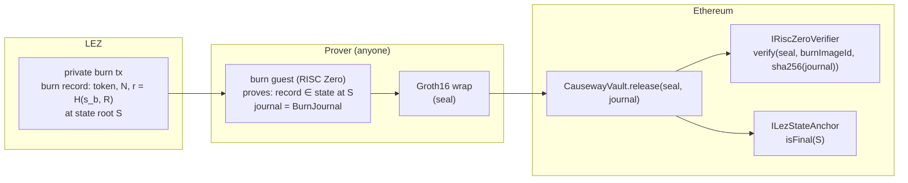

# Outbound: burn on LEZ, release on Ethereum

RFP-021 covers Ethereum → LEZ only, so the LEZ → Ethereum direction is Causeway's own work
and its heaviest new piece. The vault must learn, with no trusted party, that **a burn of
*N* of token *T*, bound to recipient *R*, happened on LEZ and will not revert**. Two
components answer that, and the vault's interface to each is already fixed and tested.

## The two components



### 1. The burn proof

A RISC Zero guest, `causeway-burn`, takes a LEZ state root *S* and a burn record with its
inclusion path, and commits the journal the vault checks:

```solidity
struct BurnJournal {
    bytes32 lezZoneId;    // pairing
    bytes32 lezProgramId; // pairing
    uint256 chainId;      // pairing
    address vault;        // pairing
    bytes32 nullifier;    // one release per burn
    address token;
    uint256 amount;
    address recipient;    // opened from r inside the guest
    bytes32 lezStateRoot; // S: the state the burn is proven against
}
```

The receipt is wrapped to Groth16 and verified by RISC Zero's audited on-chain verifier
through `IRiscZeroVerifier.verify(seal, imageId, journalDigest)` with `journalDigest =
sha256(abi.encode(journal))`. `burnImageId` is an immutable of the vault: the vault accepts
exactly one published guest, for life (Security #8).

What the guest proves is pinned in M0 against `lee_core` v0.4's state commitment structure:
the burn record is a LEZ account (a PDA of the bridge program keyed by the burn) whose
contents hash into *S* via the state-tree path the guest verifies. Stage 1 names the burn
record directly in `nullifier`; stage 2 proves membership in a burn-set accumulator and
reveals a derived nullifier instead, which unlinks the release from the burn
([PRIVACY.md](PRIVACY.md)). The vault is identical in both stages.

### 2. The settled-state anchor

A proof against state root *S* is only as good as *S*. `ILezStateAnchor.isFinal(S)` answers
whether *S* is a LEZ state root that is final to the configured depth. The vault asks it
before anything else about the proof (Functionality #12). Two routes, decided in M0:

| route | how *S* becomes final on Ethereum | depends on |
|---|---|---|
| **A. Bedrock finality light client** | an Ethereum contract tracks LEZ checkpoints and verifies Logos Bedrock's finality evidence for each (signatures or proofs, whatever Bedrock's rule is) | Bedrock's finality rule being verifiable in the EVM at acceptable gas |
| **B. Receipt composition** | the burn receipt itself composes (RISC Zero `env::verify`) a proof of LEZ block validity from the LEZ proving stack back to a checkpoint the anchor already holds; the anchor then only stores proven checkpoints | the LEZ proving stack exposing block-validity receipts the guest can compose |

Both routes keep the anchor trustless and both plug into the same `isFinal(bytes32)`. What
is **not** acceptable, and not proposed, is an attestor set or an "optimistic" anchor with
a trusted challenger: the RFP's point is that no party is trusted with funds. The anchor is
the one component whose design depends on LEZ and Bedrock internals that are still moving
in the v0.4 release candidates, so M0 settles it with measurements before the design
freezes, and the proposal says so rather than assuming it away.

`finalityDepth` in the vault is informational for clients (how many LEZ blocks the anchor
is configured to wait); finality itself is the anchor's decision. Raising the depth never
invalidates a root that is already final (tested).

## The release, step by step

1. Anyone (the holder, or a relayer paid from the amount) calls `release(seal, journal)`.
2. **Pairing**: `chainId`, `vault`, `lezZoneId`, `lezProgramId` must be this deployment's,
   or `WrongPairing`. A proof for a testnet Causeway is worthless on mainnet (tested).
3. **Finality**: `anchor.isFinal(journal.lezStateRoot)`, or `InsufficientFinality` (tested).
4. **Replay**: `spentNullifier[journal.nullifier]` must be false, or `AlreadyReleased`
   (tested).
5. **Proof**: `verifier.verify(seal, burnImageId, sha256(abi.encode(journal)))`; any
   change to any journal field, or a bad seal, is `VerificationFailed`. A relayer cannot
   redirect the recipient, inflate the amount or swap the token (tested).
6. **Operational limits**: release freeze (`FrozenError`) and per-token/global caps
   (`CapExceeded`).
7. **Supply**: `escrowed[token] ≥ amount` (tested: never pays more than is escrowed).
8. Spend the nullifier, decrement escrow, pay native ETH or the ERC-20 (empty return data
   tolerated, Functionality #17).

Measured on the in-process EVM with the mock verifier: 160,219 gas for an ERC-20 release
and 98,213 for ETH, before the real Groth16 verification ([COSTS.md](COSTS.md)).

## Burn-side details (LEZ, M2)

- The burn is a private execution: it consumes the wrapped note and writes a burn record
  `(token, N, r)` with `r = sha256("causeway/burn-recipient/v1" ‖ s_b ‖ recipient)`, where
  `s_b` comes from the seed ([RECOVERY.md](RECOVERY.md)). The burner is hidden by LEZ; the
  recipient appears nowhere on LEZ.
- The guest opens `r` with `s_b` and `recipient` and puts `recipient` in the journal, so
  only the holder of the seed can produce a release for their burn, and the recipient is
  bound inside the proof (Security #3).
- A burn is only provable once its state root is final, so the user's wait is LEZ's
  finality delay plus proving time, shown in the mini-app.

## Failsafe for the outbound leg (Security #9)

If the burn guest or verifier is found faulty, the freezer freezes releases for the token
(or globally). Wrapped tokens stay burnable and burn records stay final; once a corrected
guest exists it is deployed as a **new vault** with a new `burnImageId` and the escrow is
migrated under the documented procedure, because the verification path is immutable by
design. Holders who already burned recover through the refund path described in
[DESIGN.md](DESIGN.md): proving their own entitlement, never through an admin transfer.

## What is measured and what is not

Measured: the vault's full release path on a real EVM with every check exercised, and its
gas with a mock verifier. Not yet measured, and scheduled for M0: the real
`RiscZeroGroth16Verifier` gas on top of that path, the burn guest's cycle count, the
STARK-to-Groth16 wrapping time, and the anchor's gas under route A or B.
