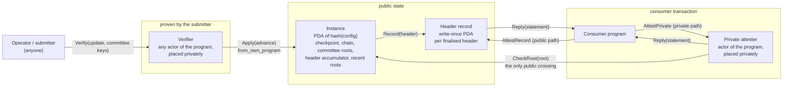

# Design

affidavit lets a LEZ program act on a fact about Ethereum and know the fact is true,
with nobody trusted after the instance is initialised. It does three things, in this
order, and nothing else: **finality** (the header is a finalised header of the canonical
chain), **inclusion** (the state or event is under that header), **predicate** (a
consumer-supplied condition holds). The output is a `Statement`; minting, escrow release
and every other action belong to the consumer.

This document describes the program on LEZ `main` (the actor model heading to testnet
v0.4), the reasons for its shape, and what is still to be validated. Every claim marked
**prototype** is implemented and tested in this repository; **design** is the plan for
the grant milestones.

## 1. Actors

| Actor | State | Who may message it | Prototype |
|---|---|---|---|
| **Instance**, at `PDA(program, config_id)` | config (chain spec, checkpoint, weak-subjectivity limit), finalised head, current and next committee roots, header accumulator peaks, last 64 accumulator roots | `Initialize`: anyone, once. `Apply`, `CheckRoot`: only this program's own actors | `lez/program` |
| **Header record**, at `PDA(program, hash(instance_id, slot))` | instance id, chain digest, `HeaderRecord` (slot, beacon root, block number, block hash, timestamp, state/receipts/transactions roots) | `Record`: only this program, written once. `AttestRecord`: anyone | `lez/program` |
| **Verifier**, any actor of the program | none | anyone | `lez/program` |
| **Private attester**, any actor of the program | none | anyone | `lez/program` |

**The address is the configuration.** An instance lives at the program-derived address
of its own configuration hash (chain id, genesis validators root, fork schedule, preset,
checkpoint root, weak-subjectivity limit). There is no instruction that rewrites it, and
there could not be a meaningful one: a different configuration is a different address.
Recovery from a bad checkpoint is initialising another instance (Functionality #9, #10,
#13, #15). Consumers bind to an instance by its id, as a constant.

## 2. Advancing an instance

The work splits along the asymmetry the RFP points at. Checking an update is expensive
(BLS12-381 pairing, hash-to-curve, 512 keys) and fully determined by public data; applying
its result is cheap. So the two are separate messages handled by separate actors:

1. **Verify** (`lc::verify_update`, pure, read-only): the submitter sends the update, the
   512 committee keys behind the root the instance tracks, and a snapshot of the instance
   state. The verifier checks participation (at least 342 of 512), slot ordering, that the
   signing committee is the one the instance tracks for that period, the execution payload
   branch of both headers, the finality branch, the handoff branch, and the aggregate
   signature. The signers' key is the committee's committed aggregate key minus the keys
   of the members that did not sign, all supplied as uncompressed points that must
   compress to the committed bytes, so no key is ever decompressed (`DECISIONS.md` D3). It
   produces an `Advance` naming the state it was computed against and sends it to the
   instance.
2. **Apply** (`lc::apply_advance`, compare-and-swap): the instance accepts an `Advance`
   only from its own program (`ReceiveInput::from_own_program()`), only if it was computed
   against the committee roots and period it holds now, and only if it moves something
   forward. A duplicate or a lost race changes nothing and fails with `AFF-207`.

### Where the 15M cycles are paid

LEZ runs the same RISC-V binary in two modes. A public actor is executed by the
sequencer under `MAX_GAS_EXEC = 10,000,000` per transaction (and per block). A private
actor is executed and proven by the submitter; the sequencer verifies one receipt at a
fixed `PRIVATE_VERIFY_GAS = 409,764`, and `Simulator::handle_message` in
`lee/state_machine` runs private transitions with no cycle cap ("bounded only by what its
prover can prove").

Measured in the program binary (`COSTS.md`), `Verify` takes 14.6M cycles for an update
that hands off the committee and 12.3M for a finality update, about 2M more at the
minimum participation: more than a public transaction may use. So there are two ways to
land it, from the same program code:

- **Private verifier (preferred, design to validate in M0).** The submitter places the
  `Verify` actor privately: it proves the verification on its own machine and the
  transaction carries one receipt. The only public execution is `Apply` (about 57,000
  cycles) and `Record` (19,600). One transaction per update, about 0.49M gas in all,
  instead of 12M to 15M over at least two transactions in two blocks. It needs no
  BLS12-381 precompile, because BLS never runs on the sequencer. The cost moves to the
  submitter's prover: 15.9M padded cycles, minutes on a GPU and about 20 to 40 minutes on
  a recent laptop CPU (estimates from a measured proof; M0 measures both). Tracking is periodic
  and latency-tolerant, so this is where the RFP's own reasoning puts it.
  The open question for M0 is concrete: on testnet 0.4, can a submitter place an actor
  of a public program privately with an empty (fresh) actor state, and does a
  private-to-public sync message arrive with `from.program_account_id` set to the
  program? The executor code says yes (`deliver_to_public` discloses the sender); the
  milestone confirms it end to end.
- **Public verifier (fallback, and the measurement the RFP asks for).** If the private
  placement does not hold, `Verify` runs publicly, split along the pairing's seams into
  transactions that each fit the cap, with the intermediate values in a program-owned job
  account. The verification code is the same; only the split is added.

Either way, `verify_update` and `apply_advance` are the single verification core, and
measuring both paths is part of the cost deliverable (Performance #2, #8).

### Following the chain

The light client is the Altair sync protocol with the Capella execution extension and the
Electra generalised indices, run as an on-chain instance should run it:

- Only finality updates signed by at least two thirds of the committee are applied. That
  is the spec's own threshold for applying an update; below it there is nothing to apply.
- No optimistic header, no force update on timeout. A forced header is one the instance
  did not see finalised; accepting one would break Reliability #3 and the fabricated-chain
  test. A stalled instance simply waits for anyone to submit the missing updates (#R7).
- Committees are tracked as roots. The instance never stores 512 keys; the submitter
  supplies them with every update and the verifier checks them against the root. This
  keeps the instance a few kilobytes and every action's cost independent of history (#P9).
- Beyond the weak-subjectivity period since its newest finalised header, an instance
  refuses to advance (`AFF-208`) and must be replaced. Headers it already verified stay
  attestable forever (#R3). See `TRUST.md`.

Prototype status: implemented in `crates/core/src/lc.rs`; exercised on real mainnet data
across five handoffs (periods 862 to 867) and the official consensus-spec-tests vectors
for Deneb and Electra; every Verification Security case is a test in
`crates/io/tests/adversarial.rs`.

## 3. Consuming a statement

Inclusion and predicate evaluation always run inside the consumer's own transaction, so
the check and the action it authorises land or fail together (#F7). Nothing a consumer
needs was computed for it in an earlier transaction; what an earlier transaction did is
verify the header, which is the point of sharing an instance.

| | Public path | Private path |
|---|---|---|
| Consumer calls | the header record actor, `AttestRecord` | a privately placed actor of the program, `AttestPrivate` |
| Header check | the record exists at its PDA | membership proof in the instance's header accumulator |
| Public crossing | which header record was read | `CheckRoot(root)`: one accumulator root shared by every consumer of the instance |
| Fits | public consumers, read-many checks | privacy-preserving consumers (the RFP-022 bridge mint) |

**Why the accumulator.** A private consumer that reads a specific header record publishes
which Ethereum block it is acting on, which links its LEZ transaction to the Ethereum
events of that block: exactly the correlation Functionality #8 forbids. Proving membership
in the accumulator inside the private execution discloses only the accumulator root, which
is the same for every consumer of the instance at that time. The instance answers
`CheckRoot` for its last 64 roots, so a private transaction proven against a slightly
older root still lands (#R11). The cost is a logarithmic membership proof: 16 hashes for
65,536 headers.

### Facts

| Fact | Proven against | Notes |
|---|---|---|
| Account (nonce, balance, code hash, storage root) | state root, MPT | absent accounts by exclusion proof |
| Storage slot | storage root of the proven account, MPT | zero values by exclusion proof |
| Log | receipts root, MPT; the log is read out of the receipt by index | identified by block hash, transaction index, log index |
| Native ETH transfer | `transactions_root` of the execution payload, SSZ; sender by signature recovery; success by the receipt at the same index | the transaction's own chain id must be the instance's |

From Gloas on, the light-client header commits only to the execution block hash. The roots
then come from the RLP execution header, checked against that hash
(`execution::verify_execution_header`). Sepolia moved to Gloas at epoch 353,024
(2026-10-06); mainnet and Hoodi have not scheduled it, so Hoodi is the first testnet
target and Gloas containers are a milestone item.

### Statement identifier

`sha256("affidavit/statement/v1" ‖ chain_digest ‖ kind ‖ …)`, where the fields are the
fact's identity: for a log its position (block hash, transaction index, log index), for a
transfer its transaction hash, for state its address, slot and value. It never includes the
instance or the header it was read under, so the same Ethereum fact read under two
instances, or under a replacement instance after migration, has one identifier and one
nullifier. `CONSUMER.md` explains why a private consumer must not publish it raw.

## 4. Chain binding

`ChainSpec::digest()` hashes the chain id, genesis validators root, the whole fork
schedule and the preset. It is part of the instance id, of every statement, and of every
statement id. A statement is checked with `Statement::check_binding(chain, instance)`. The
same contract address on mainnet and Hoodi yields different identifiers, a Sepolia-bound
consumer refuses a mainnet statement (`AFF-101`), and a mainnet transaction attested under
a Sepolia instance is refused because its EIP-155 signature binds chain id 1 (`AFF-304`).

## 5. Errors

Every refusal has a stable code (`crates/core/src/error.rs`). The program panics with
`AFF-<code> <name>: <action to take>`; the CLI's dry run prints the same string.

| Code | Name | RFP failure mode |
|---|---|---|
| 100 | malformed_input | malformed input |
| 101 | chain_mismatch | chain-ID mismatch |
| 102 | unsupported_fork | |
| 103 | instance_mismatch | statement from another instance (#F15) |
| 104 | unauthorized | message only this program's actors may send |
| 200 | participation_below_threshold | signature below the participation threshold |
| 201 | sync_committee_signature_invalid | sync-committee signature invalid |
| 202 | committee_handoff_not_verified | committee handoff not verified |
| 203 | committee_mismatch | |
| 204 | header_not_finalized | header not finalised |
| 205 | execution_not_bound | tampered state or receipts root |
| 206 | slot_ordering | |
| 207 | update_not_newer | duplicate or already applied update (#R8) |
| 208 | checkpoint_stale | checkpoint outside the weak-subjectivity period |
| 209 | checkpoint_mismatch | |
| 210 | header_unknown | header never verified by the instance |
| 300 | inclusion_proof_invalid | inclusion proof invalid |
| 301 | predicate_not_satisfied | predicate not satisfied |
| 302 | state_not_covered | predicate over state the proof does not cover |
| 303 | transaction_reverted | |
| 304 | transaction_chain_mismatch | |

## 6. Off-chain components

- **Logos core module** (design, M3): produce an attestation, verify one, submit an
  update, read an instance's configuration, and verify a checkpoint against public
  sources. All Ethereum access goes through the Logos Ethereum core module and its
  verified proxy: execution data (`eth_getProof`, block receipts, raw transactions) is
  read through `eth_rpc_module`, beacon light-client material through the module's
  beacon endpoints (an upstream addition to `logos-verified-proxy-module` if it does not
  expose them yet).
- **Update daemon** (design, M3): a Logos module with a headless CLI that follows the
  beacon chain, keeps the committee keys behind each tracked root, and runs the
  submission policy of `crates/core/src/operator.rs` (see `OPERATOR.md`).
- **CLI** (prototype: `crates/cli`): `demo`, `sync`, `attest transfer|log|state`,
  `checkpoint`.
